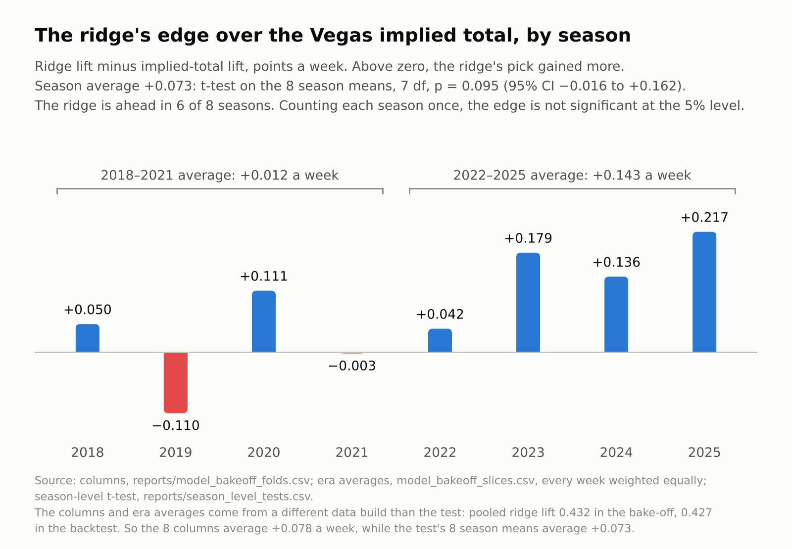

# Kicker Analysis

[](https://github.com/tdub29/Kicker-Analysis/actions/workflows/ci.yml)

Can a model pick a better fantasy kicker than the Vegas line? A little, and
this repo is mostly about how I know how little.

It forecasts weekly NFL kicker fantasy points, scores every method on the
start/sit decision a manager actually makes, publishes a board each week, and
keeps the results that did not work next to the ones that did.

| | |
|---|---|
| **data** | 14,638 kicker-games from nflverse, 1999 to 2026 week 7; the model uses the 5,945 regular-season games from 2015 on |
| **target** | each week's actual fantasy points |
| **ranking** | a ridge regression on 16 named features, all known before kickoff |
| **distribution** | two LightGBM count models for field-goal and extra-point attempts, simulated through the scoring rule |
| **output** | a weekly board in `reports/`, with a floor, a ceiling and `P(15+)` for every starter |

- **Start the kicker whose offence Vegas expects to score most.** That one
  number captures most of the value any method here finds.
- **The model adds a small edge on top of it.** A ridge regression on 16
  pre-kickoff features gains 0.427 points a week over a random start, against
  0.353 for the implied team total alone, out of 2.458 for an oracle who always
  starts the better kicker. It is ahead of the line in 6 of 8 backtest seasons;
  with eight seasons that edge is suggestive, not established (season-level
  p = 0.095).
- **Why the ceiling is low.** A kicker's week is mostly field goals, and weekly
  field-goal attempts showed close to no out-of-sample skill (R² +0.003, 95% CI
  −0.003 to +0.009). Extra-point attempts, which are touchdowns, are the
  predictable part (R² +0.126). A kicker forecast is mostly a touchdown forecast,
  which is why the betting line is hard to beat.

## Does it work

Every method is scored on one decision: take two of the week's starting kickers
at random, start the one the method prefers, and measure the points gained over
starting either at random. The lift is the exact expectation over every pair of
starters in the week, not a simulation. Eight season-forward folds, 2018 to
2025: each test season is predicted by a model trained only on the seasons
before it. 4,211 kicker-games in 141 weeks.

<picture>
  <source media="(prefers-color-scheme: dark)" srcset="docs/images/decision-lift-by-method-dark.png">
  
</picture>

| rank by | lift, pts/wk | share of oracle |
|---|---|---|
| **ridge on 16 features, which orders the board** | **0.427** | **17.4%** |
| count model's expected points | 0.362 | 14.7% |
| Vegas implied team total alone | 0.353 | 14.4% |
| kicker's own career average | 0.180 | 7.3% |
| a constant 8.0 | 0.000 | 0.0% |

The two comparisons that matter are against what people do instead:

| ridge minus | difference, pts/wk | 141 weeks as units | 8 seasons as units | seasons ahead |
|---|---|---|---|---|
| Vegas implied total alone | +0.074 | 95% CI [+0.024, +0.124], p = 0.004 | t-test p = 0.095, CI [−0.016, +0.162] | 6 of 8 |
| kicker career average | +0.247 | 95% CI [+0.156, +0.335], p < 0.0001 | t-test p = 0.001, CI [+0.132, +0.362] | 8 of 8 |

The first column of tests resamples weeks (a block bootstrap), which says the
edge over the line is clear week to week inside these eight seasons. The second
treats each season as one observation, which is the honest unit for "will it
beat the line next year", and there the edge over the line is not significant.
It loses 2019 and 2021, and most of it comes from 2022 onward:

<picture>
  <source media="(prefers-color-scheme: dark)" srcset="docs/images/ridge-vs-implied-total-by-season-dark.png">
  
</picture>

Fourteen challengers, each tuned only on seasons before its test season, were
run against the ridge in `model_bakeoff.py`: count GLMs, gradient-boosted and
pairwise rankers, a model of the residual after the betting line, a ridge with
its penalty chosen by an inner loop, and others. None is distinguishable from it
after Holm correction. The closest, the ridge plus a shrunk per-kicker effect,
is +0.012 a week (95% CI −0.010 to +0.034), ahead in 7 of 8 seasons. The
[model-selection notes](notes/model-selection-2026-09-29.md) have the full
table.

## Live 2026 record

`score_boards.py` scores each published 2026 board against what happened once
its games are final. A week counts as a forecast only if its board was committed
before kickoff. Weeks 3 and 4 are the boards as first committed; a later commit
had regenerated them after their games, and that rewrite is reverted. Weeks 5
and 6 were first committed after their games, so they are shown and not counted.

| week | kickers scored | board lift | implied-total lift | board minus implied | counted |
|---|---|---|---|---|---|
| 2 | 30 | −0.121 | +0.116 | −0.237 | yes |
| 3 | 32 | −0.239 | −0.455 | +0.216 | yes |
| 4 | 32 | +0.968 | +0.739 | +0.229 | yes |
| 5 | 28 | +1.294 | +0.522 | +0.771 | no |
| 6 | 25 | +0.473 | −0.608 | +1.082 | no |
| 7 | 26 | +0.837 | +0.669 | +0.168 | yes |
| **weeks 2, 3, 4, 7** | **120** | **+0.361** | **+0.267** | **+0.094** | |

Over the four counted weeks the board beat ranking by the implied total by 0.09
points a week, with a 95% interval of −0.26 to +0.45. Four weeks cannot tell
the two apart. Week 4's commit is dated before its games, but GitHub first
received it afterwards; counting only the boards GitHub had before kickoff
(weeks 2, 3 and 7), the edge is +0.05. The week 8 board was pushed before the
week's first game. Listed kickers who did not kick are left out of that week's
lift.

## What the probabilities are, and are not

The board also gives each kicker a full points distribution from a second
model: two LightGBM count models for field-goal and extra-point attempts, drawn
and pushed through the scoring rule by Monte Carlo. Pooled over all 4,211 test
rows its stated chance of a 15-point week matches how often it happened (8.39%
predicted, 8.41% realised). Kicker by kicker it barely beats a constant: Brier
skill over the base rate +0.001 (95% CI −0.004 to +0.006), AUC 0.55, and a
calibration slope of 0.55, so the stated chances are too spread out. At 8+ and
10+ points it over-predicts by about two percentage points.

<picture>
  <source media="(prefers-color-scheme: dark)" srcset="docs/images/calibration-reliability-dark.png">
  
</picture>

Read `P(15+)` as a rough flag for upside, not as a probability to bet on.

## What almost shipped broken

The current version is a rebuild. Most of what it does differently came from
finding these:

- **The first model never forecast anything.** My 2023 version regressed a
  team's kicker points on three six-week team averages, fit on the same rows it
  was judged on. No number in it was ever out of sample.
- **Observed weather does not exist before kickoff.** Temperature and wind
  ranked 3rd and 7th by importance, and none of the 255 unplayed games in the
  schedule file carried either. They are replaced by stadium climate: the
  venue's typical wind and temperature in that month in earlier seasons.
- **Retractable-roof state is a game-day decision.** `open` and `closed` never
  appear on an unplayed game, yet 15.1% of training rows carried one. The first
  fix keyed the building on a column the table did not have, so both roof flags
  became constant and "16 features" were 14. The flags now come from the game's
  venue, and the backtest refuses to run if any of the 16 stops varying.
- **An exclusion list is not a feature set.** The first feature list admitted
  every numeric column nobody had banned. When 17 columns were merged into the
  frame, all 17 were accepted silently; three were same-game outcomes, and MAE
  fell from 3.49 to 2.65. The features are now an explicit list of 16 names.
- **The 2021 season was missing.** The upstream kicking release skips it, and
  every metric looked healthy without its 561 games. The build now rebuilds any
  missing season from play-by-play and stops if a season is incomplete.
- **A fresh clone quietly built 4 of 12 seasons of coach data.** The
  fourth-down features read whatever play-by-play happened to be cached, so a
  new checkout imputed them for most seasons and the backtest still ran green.
  The build now downloads every season and fails on a gap, and the backtest
  checks each feature's coverage season by season.
- **The headline was briefly a number the code could not print.** The README
  quoted the ridge while `backtest.py` never fit one. The ridge is now a row in
  that table, and every result table and chart in this README is regenerated
  from a CSV in `reports/`.

## What did not work

Kept because a null result is a result.

Three more feature families were built and re-tested under the current ridge
with the exact lift (`experiments/feature_families/ridge_retest.py`):

| added to the 16 | columns | MAE | within-week ρ | lift, pts/wk |
|---|---|---|---|---|
| nothing | 0 | 3.472 | 0.171 | 0.427 |
| red-zone efficiency | +27 | 3.476 | 0.149 | 0.370 |
| drive-level offence | +21 | 3.482 | 0.168 | 0.418 |
| leg strength and stadium | +13 | 3.473 | 0.159 | 0.396 |
| all three | +61 | 3.485 | 0.142 | 0.347 |

Every family made the ranking worse. None beats its own columns shuffled within
each season on lift; drive-level offence comes closest, ahead of 46 of 50
shuffles.

Willingness to attempt long field goals was measured separately
(`experiments/fifty_plus/`). League-wide, the share of fourth downs in 50+
range that became field-goal attempts rose from 0.274 in 2015 to 0.440 in 2025.
But a team gets a median of 9 such chances a season, so much of the
team-to-team spread is sampling noise (about two-thirds of it in the median
season), and adding a shrunk team rate to the ridge gains +0.002 a week (95% CI
−0.007 to +0.012, p = 0.64), ahead in 4 of 8 seasons. Not added.

Three earlier claims were retracted when the evidence did not hold them up.
Field-goal attempts were described as having negative skill (R² −0.054); on the
current models they have about zero. A separate "ceiling" board was said to be
needed to catch big weeks; ranking by expected points already beats random on
15-point weeks. And `P(15+)` was called calibrated; it is right on average only.
[METHOD.md](METHOD.md) has each one and the numbers behind it.

## What transfers beyond football

- Score the decision, not the error. By MAE the count model (3.493) barely
  beats a constant (3.504); on the start/sit decision it gains 0.362 a week and
  the constant gains nothing.
- Benchmark against the market, and report the share of an oracle, so a small
  edge reads as small.
- Name every feature, check each exists before kickoff, and assert that each
  varies and is populated in every season.
- Count seasons, not weeks, when the question is next season.

## Quick start

Python 3.11 or newer.

```bash
pip install -r requirements.txt     # or: pip install -e ".[dev]"
export OMP_NUM_THREADS=1            # LightGBM thread contention can turn a one-second fit into minutes

python scripts/run_pipeline.py      # every step below, in order; stops at the first failure
```

or one step at a time:

```bash
python src/kicker_analysis/build_dataset.py     # nflverse to one row per kicker per game
python src/kicker_analysis/fourth_down.py       # coach aggression, every season 2015 on
python src/kicker_analysis/backtest.py          # the tables above
python src/kicker_analysis/figures.py           # the charts above
python src/kicker_analysis/score_boards.py      # the live 2026 record
python src/kicker_analysis/predict_week.py      # this week's board
python src/kicker_analysis/model_bakeoff.py     # 14 challengers against the ridge, a few minutes
```

Inputs are fetched live, so a rerun on later data can move the last digit;
`reports/data_manifest.json` records the hash of every input behind the tracked
CSVs. Most modules carry an assert-based `--self-check` that runs offline on
synthetic data. `pytest -q` runs all of them with the network blocked, and CI
runs that on Python 3.11 to 3.13.

## Layout

```
src/kicker_analysis/
  build_dataset.py   nflverse to one row per kicker per game, with parity checks
  fourth_down.py     coach aggression on 4th down in FG range, per team-game
  features.py        lagged features, all knowable before kickoff
  model.py           RidgeRanker (ordering) + CompoundKickerModel (distribution)
  backtest.py        season-forward evaluation on the decision metric
  model_bakeoff.py   14 challengers against the ridge, nested and Holm-corrected
  predict_week.py    this week's board
  score_boards.py    the published 2026 boards against what happened
  figures.py         the charts, drawn only from the tracked CSVs
  evaluate.py        bootstrap utilities
  feat_*.py          three candidate feature families, none adopted
scripts/run_pipeline.py  every step in order, or every module's --self-check
tests/               pytest over every self-check, offline; run by CI
reports/             tracked evidence CSVs and the weekly boards
experiments/         the feature-family and 50+ studies
notes/               dated decision write-ups
legacy/              the R and Python versions this replaced, and why each was retired
docs/                which module writes and reads which file; every column defined
METHOD.md            the full argument, every number, and what was retracted
```

## Data and license

Play-by-play and the kicking release are from
[nflverse-data](https://github.com/nflverse/nflverse-data) (CC BY 4.0), and
schedules and betting lines from [nflverse/nfldata](https://github.com/nflverse/nfldata).
No keys needed. Code is MIT licensed.

## More projects

More of my work and contact details are at [twhite.dev](https://twhite.dev).
